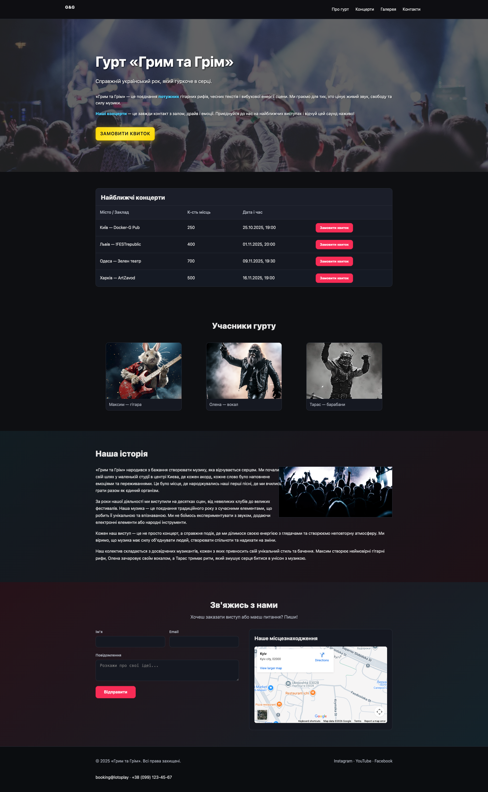

# Грим та Грім — лендинг рок-гурту

Односторінковий лендинг українського рок-гурту «Грим та Грім»: промо-блок, розклад концертів
із замовленням квитків, склад гурту, історія та форма зворотного зв'язку.

Проєкт виконано як тестове завдання (верстка та фронтенд на React).

**Живе демо:** https://lotopay-landing.vercel.app



## Стек

- **React 19** — UI
- **Vite** — збірка та dev-сервер
- **CSS Modules** — ізольовані стилі компонентів
- **react-hook-form** — форми та валідація
- **axios** — HTTP-запити
- **react-hot-toast** — сповіщення
- **ESLint** — статичний аналіз

## Функціонал

- Адаптивна верстка (перевірено на 375, 768 і 1440 px, без горизонтального скролу)
- Модалка замовлення квитка: ім'я, email, кількість квитків (1–10) і вибір концерту
  з валідацією через react-hook-form та екраном успіху
- Кнопка в hero відкриває форму з порожнім вибором концерту, кнопки в таблиці —
  з уже вибраним концертом
- Доступність модалки: закриття по Esc і кліку на оверлей, фокус у першому полі,
  повернення фокуса на кнопку після закриття
- Розклад концертів: дати зберігаються в ISO 8601, форматуються через
  `Intl.DateTimeFormat('uk-UA')`; минулі концерти ховаються автоматично,
  а без майбутніх дат показується «Нові дати незабаром»
- Форма контактів з валідацією та `axios.post` (JSON-тіло) на тестовий API
- AI-згенеровані зображення учасників гурту та концерту
- SEO-розмітка: title, meta description, Open Graph, theme-color

## Запуск

```bash
npm install
npm run dev
```

Застосунок буде доступний на http://localhost:5173

## Інші команди

```bash
npm run build     # продакшн-збірка в dist/
npm run preview   # локальний перегляд збірки
npm run lint      # перевірка ESLint
```

## Структура

```
src/
├── assets/        # зображення
├── components/    # компоненти секцій, кожен зі своїм CSS-модулем
│   ├── Band/        склад гурту
│   ├── Concerts/    розклад концертів
│   ├── Contact/     форма зворотного зв'язку
│   ├── Footer/
│   ├── Header/
│   ├── Hero/
│   ├── History/     історія гурту
│   ├── Modal/       базова модалка
│   └── TicketOrder/ форма замовлення квитка
├── data/          # дані концертів і хелпери дат
├── App.jsx
├── main.jsx
└── index.css      # глобальні стилі
```
